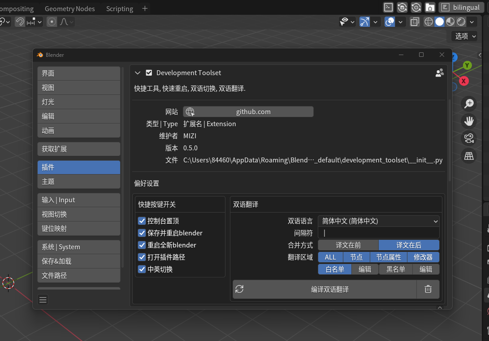
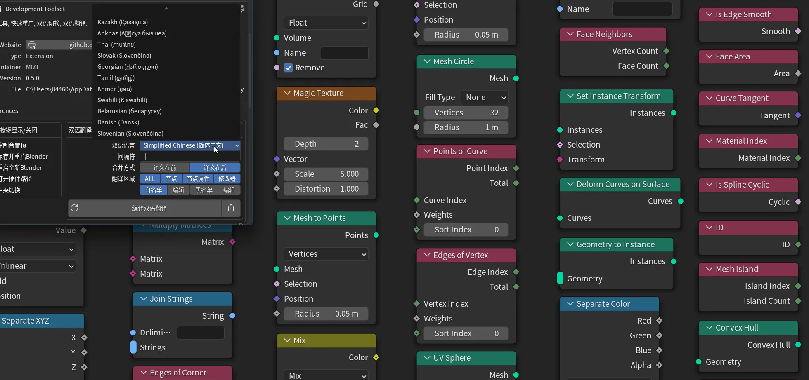

# BilingualTranslationToolkit

[ZH](https://github.com/zxsama/BilingualTranslationToolkit/blob/main/README.md) | [EN](https://github.com/zxsama/BilingualTranslationToolkit/blob/main/README_EN.md)

一个用于blender的双语界面显示的工具集。

> Blender 3.6–5.3 可使用同一个安装 ZIP。3.6–4.1 在「插件」中安装；4.2 及更新版本通过「从磁盘安装」识别为扩展。

## 双语界面翻译

从Blender原有翻译文件编译的双语界面，支持Blender内置的大多数语言和一定程度的格式定义，也支持对单个词语的黑、白名单。

> 初次使用：
>   1. 安装插件
>   2. 点击插件设置中的 `双语翻译初始化(自动重启)` 按钮
>   3. 等待blender自动重启
>   4. 再次点击插件设置中的 `编译双语翻译` 按钮

### 按界面区域翻译

在「翻译区域」关闭「所有」（英文 `ALL`）按钮，选中需要的区域并重新编译：

- **顶栏菜单**：顶栏菜单名称及 Blender 能识别的内置菜单项。
- **节点 / 节点属性**：「节点」只选中节点编辑器「添加」菜单内可识别的条目（不包括菜单栏的「添加」标题，也不包括其他菜单）；「节点属性」包括实际声明的属性和选项。Blender 3.6–5.3 各系列使用相应的内置插口和节点内面板条目。自定义插口、未收录的动态名称和官方词库没有译文的内容不保证覆盖。
- **属性编辑器 / 修改器**：属性编辑器的面板标题及修改器相关条目；可只选修改器名称、分类、字段和 Blender 自带的修改器资产。

Blender 原生界面用「翻译语境 + 英文原文」查字典，不传入编辑器或区域。同名但语境不同的条目仍分开匹配；完全相同的条目只要属于任一选中区域，就会在所有共用位置显示双语。未选中的其他条目保留原来的单语译文。

白名单可用 `NodeTree :: Add` 精确补充一条翻译，`* :: 文件的英文名` 表示默认语境。此类手动条目仍然全局生效。旧的纯文本白名单在只选白名单时，仅接受唯一且非默认语境的条目；不再自动扩展已勾选区域。纯文本黑名单仍然屏蔽所有同名条目，也可以用同样的语境写法精确屏蔽。关闭「覆盖原始语言」可保留原始单语语言选项。

### 迁移和卸载

如果在 Blender 启动画面使用「复制上一个版本的设置」，迁移后请在新版本重新编译双语词库，不需要先清空配置。迁移保留原本的安装形式：传统插件不会自动变成扩展，避免同时启用两套。

卸载前如需清除词库，请先在插件设置点删除按钮。「重置本插件的翻译设置」只会额外重置本插件的翻译选项，不会删除整个语言目录。新版能恢复自己记录过的原语言覆盖；旧版本未记录的覆盖不会被猜测或覆盖。

## 快捷按键：

### 按键功能：

- 控制台置顶(仅Windows)
- 保存并重启Blender
- 重启全新Blender
- 打开插件路径
- 语言切换

### 功能演示

## Q&A

1. 为什么有未双语显示的文本？

- 本插件使用官方翻译文本进行双语显示，官方文本中未翻译的内容同样也不会显示。

2. 为什么安装后不显示双语翻译？

- 第一次使用需要按照上述初次使用中的步骤设置，如有报错可以提交issue。

