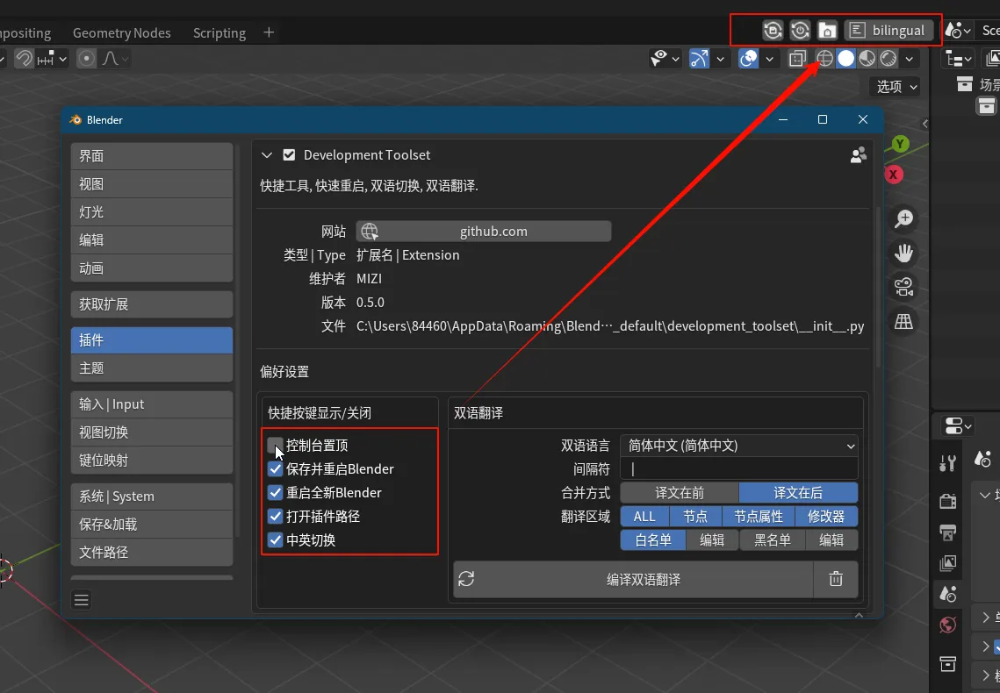

# Bilingual Translation Toolkit

[ZH](https://github.com/zxsama/BilingualTranslationToolkit/blob/main/README.md) | [EN](https://github.com/zxsama/BilingualTranslationToolkit/blob/main/README_EN.md)

A toolkit for displaying bilingual interfaces in Blender.

> The same ZIP works on Blender 3.6–5.3. In 3.6–4.1 install it from Add-ons; in 4.2 and newer Install from Disk recognizes it as an extension.

## Bilingual Interface Translation

A bilingual interface compiled from Blender's original translation files. Supports most languages built into Blender with format customization, and allows word-level whitelist/blacklist filtering.

> First-time setup:
> 1. Install the addon
> 2. Click the `Bilingual Translation Initialization (Auto Restart)` button in addon preferences
> 3. Wait for Blender to restart automatically
> 4. Click the `Compile Bilingual Translation` button again

### Select UI areas

Under **Translation Area**, turn off **ALL**, choose areas, and recompile. **Topbar Menus** covers menu names and statically identifiable built-in menu items. **Node** covers identifiable entries inside the node editor’s Add menu, not the Add header or other menus; **Node Property** includes declared properties, options, and built-in socket and in-node panel keys for the corresponding Blender 3.6–5.3 series. Custom sockets, unlisted dynamic labels, and entries missing official translations are not guaranteed. **Properties Editor** includes panel titles and modifier entries. **Modifier** alone covers names, categories, fields, and shipped modifier assets.

Blender uses one global translation catalog keyed by context and source text. Identical keys used by multiple UI locations become bilingual everywhere when any selected area includes them. Same-text entries in other contexts remain independent. Excluded entries retain their original single-language translation.

Use `NodeTree :: Add` (or `* :: Text` for the default context) in the allowlist to add an exact key globally. Plain-text allowlist entries apply only in allowlist-only mode and only when they resolve to one non-default context. Plain-text denylist entries still block all contexts; qualified denylist entries block only that key. Leave **Override the original language** off to keep the original single-language locale.

### Migration and removal

After **Copy Previous Settings**, recompile against the new Blender installation. Migration preserves the existing installation type; a legacy add-on does not automatically become an extension. Avoid enabling both copies.

To remove the generated catalog, use the Toolkit's Delete button before uninstalling. Its optional reset affects only the Toolkit's translation preferences, not the entire user locale directory. Overrides tracked by this version can be restored; overrides created by older versions without tracking are left alone.

## Quick Access Buttons

### Button Functions:
- Console Pin to Top(Only Windows)
- Save and Restart Blender
- Restart Fresh Blender
- Open Addon Path
- Language Switching

### Demo Video

## Q&A

1. Why are some texts not displayed bilingually?
- The addon uses official translations. Texts untranslated in official packages will remain monolingual.

2. Why isn't bilingual display working after installation?
- First-time users must follow the initial setup steps above. Please submit an issue if errors persist.
